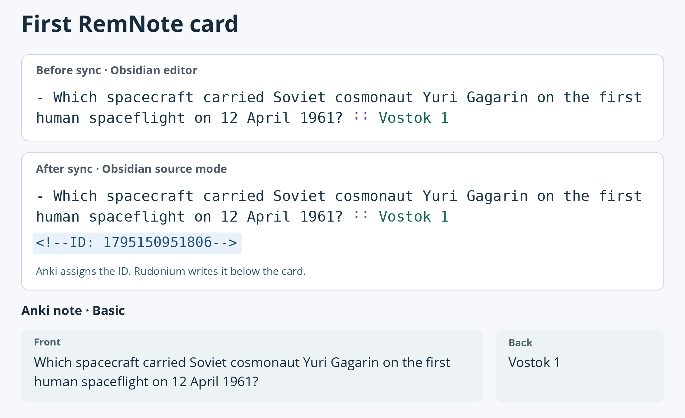

[English](README.md) | [Русский](README.ru.md)

# Rudonium Anki Toolkit

Turn Markdown notes in Obsidian into Anki flashcards for spaced repetition. Preview what will change, export cards to desktop Anki, or turn on bidirectional sync to bring edits back into Obsidian.

Rudonium keeps a file index to speed up repeat exports. In a benchmark with 20,000 previously exported cards in 20,000 unchanged Markdown files, a one-way vault scan took **0.16 s with Rudonium** and **54.1 s with Obsidian_to_Anki**. 

Development and support are on GitFlic. GitHub mirrors the source code and hosts releases for Obsidian. Please use GitFlic Issues for bug reports, questions, and feature requests. [GitFlic Issues](https://gitflic.ru/project/dashiwak/rudonium-anki-toolkit/issue) · [GitFlic repository](https://gitflic.ru/project/dashiwak/rudonium-anki-toolkit) · [GitHub mirror](https://github.com/Dashiwak/rudonium-anki-toolkit)

[Documentation](docs/README.md) · [Quick start](docs/en/quick-start.md) · [Migrate existing card files](docs/en/migrate-card-files.md) · [Suspension, deletion, and shared fields](docs/en/card-controls.md) · [Release notes](CHANGELOG.md)

## What you can do

- Write cards on a single line, in a marked block, or on **a dedicated page**. Choose a built-in Markdown format for an Anki note type or define your own with a regular expression.
- Sync supported fields in either direction. With **bidirectional sync** enabled, an edit to a linked field in Anki can update the corresponding text in Obsidian.
- **Audit a deck** to find missing IDs and differences between Anki and your vault. In collections with tens of thousands of cards accumulated over several years, an audit helps identify notes that have lost their links. Review each match before restoring the link.
- **Preview an export**, check the destination deck, and choose which files to send. Map folders to decks to keep different subjects in separate decks.
- **Sync a single card**. Place the cursor in the card, run Preview Current Card, then choose Sync this card to review and apply the changes.
- **Back up a vault** or selected folders, and transfer Markdown files and attachments in a ZIP archive.
- **Migrate Markdown files** containing one card each from supported plugins. The wizard recognizes supported page, block, and single-line formats and converts them into Rudonium page cards. 
- Cards created with **Obsidian_to_Anki** can continue syncing in their existing format. Configure Rudonium with the same card markers, regular expressions, and field mappings you used previously. Keep the existing Anki note IDs to preserve links and review history.

## Setup

1. Open desktop Anki on the computer where you use Obsidian. Select the Anki profile where you want to study your cards. [Download Anki](https://apps.ankiweb.net/)
2. In Anki, open **Tools → Add-ons → Get Add-ons**, enter `2055492159`, and restart Anki. If AnkiConnect is already installed, check that it is enabled. [AnkiConnect on AnkiWeb](https://ankiweb.net/shared/info/2055492159)
3. Open **Tools → Add-ons**, select **AnkiConnect**, and click **Config**. Add `"app://obsidian.md"` to the `webCorsOriginList` array. Keep your existing entries and other settings. This example shows the default local connection with Obsidian added.

   ```json
   {
     "apiKey": null,
     "apiLogPath": null,
     "webBindAddress": "127.0.0.1",
     "webBindPort": 8765,
     "webCorsOrigin": "http://localhost",
     "webCorsOriginList": [
       "http://localhost",
       "app://obsidian.md"
     ]
   }
   ```

4. Save the configuration, restart Anki, and leave the selected profile open while you work in Obsidian.
5. Open your vault in desktop Obsidian **1.15.1 or later**. Under **Settings → Community plugins**, enable community plugins if prompted. Choose **Browse** and search for **Rudonium Anki Toolkit**. If it is listed, click **Install**, then **Enable**. You can also install from the release ZIP as described below. [Download Obsidian](https://obsidian.md/)
6. The plugin starts in English. To change the language, open **Interface and plugin information → Interface Language** in its settings and reload the plugin to update command names. Open **Anki Connection → Quick Start → Set up sync** and click **Check Connection**. Check that the profile name matches the one open in Anki. Continue with **Set up your first card** below to choose your deck, note type, and card format.

### Manual installation from a release ZIP

1. Open the release you want on GitFlic and download `Rudonium-<version>-Install.zip`. [GitFlic project](https://gitflic.ru/project/dashiwak/rudonium-anki-toolkit)
2. Extract the ZIP into your vault’s `.obsidian/plugins/` folder. Inside `rudonium-anki-toolkit/` you should see `main.js`, `manifest.json`, and `styles.css`. If your vault uses a custom configuration folder, use that folder in place of `.obsidian`.
3. Open **Settings → Community plugins** and enable **Rudonium Anki Toolkit**. To update an existing installation, close Obsidian, replace the release files in the existing plugin folder, and reopen the vault. Check the version in the plugin settings.

## Set up your first card

A RemNote-style card fits on one line. The question goes before `::` and the answer after it. This example uses the **Basic** Anki note type, which has two fields, **Front** and **Back**.

1. **Choose the format.** Quick Start opens automatically in a new vault with no card rules or complete pairs of card markers. You can reopen it with the **Quick Start** command. Click **Check Connection** if the deck selector is not visible. Choose an ordinary deck, such as **Default**, the note type **Basic**, and the card format **RemNote · single line**. The preset fills in the rule for you. You can also expand **RemNote regular expression** to copy it, or follow the [manual setup instructions](#enter-the-remnote-rule-manually) below. If you use the preset, check the front and back of the sample, then click **Save Setup**.
2. **Write one card.** Create a Markdown note in a folder included in your sync profile. Paste just this line into the editor as ordinary text and save the note.

   ```markdown
   - Which spacecraft carried Soviet cosmonaut Yuri Gagarin on the first human spaceflight on 12 April 1961? :: Vostok 1
   ```

3. **Preview and export.** Leave bidirectional sync off for this example (the default). Place the cursor on the card, open the command palette, and run **Preview Current Card**. Check the destination deck. **Front** should read `Which spacecraft carried Soviet cosmonaut Yuri Gagarin on the first human spaceflight on 12 April 1961?` and **Back** should read `Vostok 1`. Choose **Sync this card**, review the proposed creation, and click **Export Changes**.
4. **Find the ID.** After a successful export, switch the note to **Source mode**. Rudonium writes the ID assigned by Anki directly below the card. Your number will be different.

   ```markdown
   - Which spacecraft carried Soviet cosmonaut Yuri Gagarin on the first human spaceflight on 12 April 1961? :: Vostok 1
   <!--ID: 1795150951806-->
   ```

   By default the ID is an HTML comment, hidden in Reading view. With **ID Comments** turned off, the line reads `ID: 1795150951806` instead. Leave your generated ID in place when editing the question or answer. To see the linked note in Anki, place the cursor on the card and run **Open Current Card in Anki**.



### Enter the RemNote rule manually

If you selected the preset above, the rule is already saved. To enter the same expression by hand, open the plugin settings and expand **Note type rules**. Next to **Basic**, click **Edit**. If it has no rule yet, click **+ Add rule** and select **Basic**. Under **Card format**, choose **Custom regular expression**. Paste the following line into **Regular expression**, exactly as shown, then click **Save rule**.

```regex
^(?:[-*+][ \t]+)?((?!::)[^\s](?:(?:(?!::)[^\r\n])*?(?!::)[^\s])?)[ \t]*::(?!:)[ \t]*((?!::)[^\s](?:(?:(?!::)[^\r\n])*?(?!::)[^\s])?)(?:[ \t]*::[ \t]*(?:R|[FB]=[a-z]{2,3}\\?_[A-Z]{2}\.?))*[ \t]*(?=\r?$)
```

The first capture group fills the first Anki field (the question), and the second fills the next field (the answer). Paste only the expression into the setting, without surrounding slashes or flags. In your Markdown note, enter the question and answer as in step 2. [More card formats](docs/en/card-formats.md)

## Data and access

Rudonium sends the selected cards’ fields, tags, deck names, and associated media to AnkiConnect on the computer running Anki. The default connection uses local port `8765`. Vault backups and ZIP transfers use the locations you choose. Optional Anki backups read the local collection and its media. Rudonium has no telemetry and requires no Rudonium account.

## Support and contributions

Open an issue on GitFlic in English or Russian. Include your plugin, Obsidian and Anki versions and a small Markdown example. The author of Rudonium is **dashiwak**. [GitFlic Issues](https://gitflic.ru/project/dashiwak/rudonium-anki-toolkit/issue) · [Contributing](CONTRIBUTING.md)

## License and credits

GPL-3.0-only. Rudonium is based on **Obsidian_to_Anki 3.6.0**, by Pseudonium and the upstream contributors. [License](LICENSE) · [Notices](NOTICE.md) · [Upstream](https://github.com/ObsidianToAnki/Obsidian_to_Anki)
