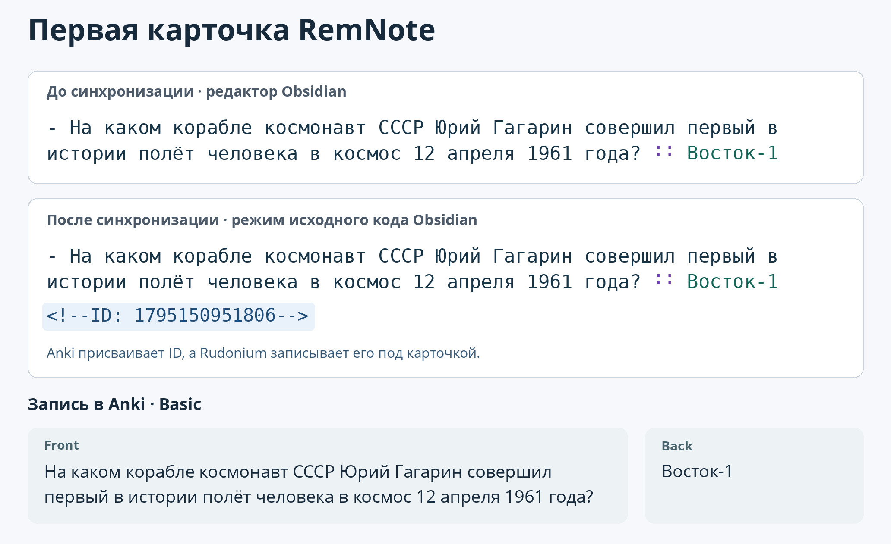

[English](README.md) | [Русский](README.ru.md)

# Rudonium Anki Toolkit

Создавайте в Markdown-заметках Obsidian карточки для интервального повторения в Anki. Перед экспортом проверяйте, какие записи изменятся в настольной Anki. Включите двустороннюю синхронизацию, чтобы правки из Anki попадали и в Obsidian. 

Rudonium ведёт индекс файлов, чтобы ускорить повторный экспорт. В тесте с **20 000 ранее экспортированных карточек в 20 000 неизменённых Markdown-файлах** односторонняя проверка хранилища заняла **0,16 с у Rudonium** и **54,1 с у Obsidian_to_Anki**.

Разработка и поддержка ведутся на GitFlic. На GitHub размещены зеркало исходного кода и выпуски для Obsidian. Сообщить об ошибке, задать вопрос или предложить улучшение можно в разделе задач на GitFlic. [Задачи на GitFlic](https://gitflic.ru/project/dashiwak/rudonium-anki-toolkit/issue) · [Репозиторий на GitFlic](https://gitflic.ru/project/dashiwak/rudonium-anki-toolkit) · [Зеркало на GitHub](https://github.com/Dashiwak/rudonium-anki-toolkit)

[Документация](docs/README.md) · [Быстрый старт](docs/ru/quick-start.md) · [Перенос существующих файлов с карточками](docs/ru/migrate-card-files.md) · [Приостановка, удаление и общие поля](docs/ru/card-controls.md) · [История изменений](CHANGELOG.md)

## Возможности

- Записывайте карточки в одну строку, в блок с маркерами или на **отдельной странице**. Для каждого типа записи Anki можно выбрать готовый формат Markdown или задать свой с помощью регулярного выражения.
- Синхронизируйте поддерживаемые поля в обоих направлениях. При **двусторонней синхронизации** правка связанного поля в Anki может обновить соответствующий текст в Obsidian.
- Сверяйте колоду Anki с хранилищем Obsidian, чтобы находить пропущенные ID и расхождения между записями. Если за несколько лет накопились десятки тысяч карточек, **аудит** помогает найти записи, у которых нарушилась связь. Перед восстановлением связи можно проверить найденное соответствие.
- **Предварительно просматривайте** экспорт, проверяйте колоду назначения и выбирайте файлы для отправки. Назначайте колоды отдельным папкам, чтобы распределить карточки по темам.
- **Синхронизируйте карточки** по одной. Поставьте курсор в карточку, выполните команду «Предпросмотр текущей карточки» и нажмите «Синхронизировать эту карточку», чтобы проверить и применить изменения.
- Создавайте **резервные копии хранилища** или отдельных папок. Переносите Markdown-файлы и вложения в ZIP-архиве.
- Переносите **Markdown-файлы с одной карточкой** из поддерживаемых плагинов. Мастер распознаёт поддерживаемые форматы страниц, блоков и однострочных карточек и преобразует их в карточки-страницы Rudonium. 
- Карточки, созданные с помощью **Obsidian_to_Anki**, можно продолжать синхронизировать в их текущем формате. Для этого укажите в Rudonium прежние маркеры карточек, регулярные выражения и соответствия полей. Сохраните существующие ID Anki, чтобы сохранить связь с записями и историю повторений.

## Установка и подключение

1. Откройте настольную Anki на том же компьютере, где работает Obsidian. Выберите профиль Anki, в котором будете повторять карточки. [Скачать Anki](https://apps.ankiweb.net/)
2. В Anki откройте **Инструменты → Дополнения → Загрузить дополнения**, введите код `2055492159` и перезапустите Anki. Если AnkiConnect уже установлен, проверьте, что дополнение включено. [AnkiConnect на AnkiWeb](https://ankiweb.net/shared/info/2055492159)
3. Откройте **Инструменты → Дополнения**, выберите **AnkiConnect** и нажмите **Настройки** (**Config**). Добавьте `"app://obsidian.md"` в список `webCorsOriginList`. Сохраните остальные адреса и параметры. Ниже приведён пример стандартного локального подключения с добавленным адресом Obsidian.

   ```json
   {
     "apiKey": null,
     "apiLogPath": null,
     "webBindAddress": "127.0.0.1",
     "webBindPort": 8765,
     "webCorsOrigin": "http://localhost",
     "webCorsOriginList": [
       "http://localhost",
       "app://obsidian.md"
     ]
   }
   ```

4. Сохраните настройки, перезапустите Anki и оставьте выбранный профиль открытым на время работы с карточками в Obsidian.
5. Откройте хранилище в настольном Obsidian **1.15.1 или новее**. Перейдите в **Настройки → Сторонние плагины** и разрешите их использование, если потребуется. Откройте каталог и найдите **Rudonium Anki Toolkit**. Если плагин есть в списке, нажмите **Установить**, затем **Включить**. Плагин также можно установить из ZIP-архива выпуска по инструкции ниже. [Скачать Obsidian](https://obsidian.md/)
6. При первом запуске интерфейс плагина на английском. Чтобы перейти на русский, в настройках Rudonium откройте **Interface and plugin information → Interface Language**, выберите **Русский** и перезапустите плагин, чтобы обновились названия команд. Откройте **Подключение к Anki → Быстрый старт → Настроить синхронизацию** и дождитесь автоматической проверки соединения. Убедитесь, что показано имя профиля, открытого в Anki. В разделе **Как создать первую карточку** ниже описано, какую колоду, тип записи и формат выбрать.

После включения Rudonium на крайней левой панели Obsidian появляется кнопка Anki . При наведении видна подсказка **Rudonium — Синхронизировать хранилище с Anki**. Нажатие запускает синхронизацию папок активного профиля. При первой установке он охватывает всё хранилище. Чтобы сначала попробовать на одной карточке, выполните шаги раздела **Как создать первую карточку** ниже.

### Ручная установка из ZIP-архива выпуска

1. Откройте нужный выпуск на GitFlic и скачайте установочный архив `Rudonium-<версия>-Install.zip`. [Проект на GitFlic](https://gitflic.ru/project/dashiwak/rudonium-anki-toolkit)
2. Распакуйте архив в каталог `.obsidian/plugins/` своего хранилища. Внутри папки `rudonium-anki-toolkit/` должны находиться файлы `main.js`, `manifest.json` и `styles.css`. Если вы сменили каталог конфигурации хранилища, используйте его вместо `.obsidian`.
3. Откройте **Настройки → Сторонние плагины** и включите **Rudonium Anki Toolkit**. Чтобы обновить плагин, закройте Obsidian, замените файлы выпуска в существующей папке плагина и снова откройте хранилище. Проверьте версию в настройках плагина.

## Как создать первую карточку

Карточка в стиле RemNote помещается на одной строке. Вопрос записывается до разделителя `::`, ответ — после. Для примера подойдёт стандартный тип записи Anki **Basic** («Простая») с двумя полями — **Front** для вопроса и **Back** для ответа.

1. **Выберите колоду и тип записи.** Откройте **Быстрый старт** и выберите обычную колоду, например **Default**. В разделе **Типы записей** нажмите **Добавить тип записи** или **Изменить** рядом с уже настроенным типом **Basic**. В окне правила укажите **Basic** и формат **RemNote · одна строка**. Сверьте вопрос о Юрии Гагарине и ответ на обороте. Нажмите **Сохранить правило**, затем **Сохранить настройки** в окне быстрого старта.
2. **Напишите карточку.** Создайте Markdown-заметку в папке, которая входит в ваш профиль синхронизации. Вставьте в редактор только эту строку как обычный текст и сохраните заметку.

   ```markdown
   - На каком корабле космонавт СССР Юрий Гагарин совершил первый в истории полёт человека в космос 12 апреля 1961 года? :: Восток-1
   ```

3. **Проверьте и экспортируйте.** Для этого примера оставьте двустороннюю синхронизацию выключенной, как при первой установке. Поставьте курсор на строку карточки, откройте палитру команд и выполните **Предпросмотр текущей карточки**. Проверьте колоду назначения. В поле **Front** должно быть `На каком корабле космонавт СССР Юрий Гагарин совершил первый в истории полёт человека в космос 12 апреля 1961 года?`, в **Back** — `Восток-1`. Нажмите **Синхронизировать эту карточку**, проверьте, что предлагается создать новую запись, и нажмите **Экспортировать изменения**.
4. **Найдите ID.** После успешного экспорта переключите редактор заметки в режим исходного кода. Под строкой карточки появится ID, который Anki присвоила новой записи. У вас число будет другим.

   ```markdown
   - На каком корабле космонавт СССР Юрий Гагарин совершил первый в истории полёт человека в космос 12 апреля 1961 года? :: Восток-1
   <!--ID: 1795150951806-->
   ```

   По умолчанию ID записывается в HTML-комментарий и скрыт в режиме чтения. Если выключить **Хранить ID в HTML-комментариях**, появится строка `ID: 1795150951806`. Оставьте свой ID на месте, когда будете редактировать вопрос или ответ. Чтобы увидеть связанную запись в Anki, поставьте курсор на карточку и выполните команду **Открыть текущую карточку в Anki**.



### Как ввести правило RemNote вручную

Если вы выбрали готовый формат выше, правило уже сохранено. Чтобы ввести то же выражение вручную, откройте в настройках плагина **Правила типов записей**. Нажмите **Изменить** рядом с **Basic**. Если у этого типа ещё нет правила, нажмите **Добавить тип записи** и выберите **Basic**. В списке **Формат карточки** выберите **Своё регулярное выражение**. Скопируйте строку целиком в поле **Регулярное выражение** и нажмите **Сохранить правило**.

```regex
^(?:[-*+][ \t]+)?((?!::)[^\s](?:(?:(?!::)[^\r\n])*?(?!::)[^\s])?)[ \t]*::(?!:)[ \t]*((?!::)[^\s](?:(?:(?!::)[^\r\n])*?(?!::)[^\s])?)(?:[ \t]*::[ \t]*(?:R|[FB]=[a-z]{2,3}\\?_[A-Z]{2}\.?))*[ \t]*(?=\r?$)
```

Первая группа захвата заполняет первое поле Anki (вопрос), вторая — следующее поле (ответ). Вставляйте в настройку само выражение, без косых черт по краям и без флагов. В Markdown-заметке напишите вопрос и ответ, как на шаге 2. [Другие форматы карточек](docs/ru/card-formats.md)

## Данные и доступ

Rudonium передаёт AnkiConnect поля выбранных карточек, теги, названия колод и связанные медиафайлы на компьютере, где открыта Anki. По умолчанию используется локальный порт `8765`. Для резервного копирования хранилища и переноса файлов в ZIP-архиве используются выбранные вами папки. При резервном копировании Anki плагин читает локальную коллекцию и её медиафайлы. В Rudonium нет телеметрии. Учётная запись Rudonium не требуется.

## Поддержка и участие в проекте

Задайте вопрос или сообщите об ошибке на GitFlic на русском или английском языке. Укажите версии плагина, Obsidian и Anki и приложите небольшой пример Markdown. Автор Rudonium — **dashiwak**. [Задачи на GitFlic](https://gitflic.ru/project/dashiwak/rudonium-anki-toolkit/issue) · [Как участвовать в проекте](CONTRIBUTING.md)

## Лицензия и авторы

GPL-3.0-only. В основе Rudonium — **Obsidian_to_Anki 3.6.0**, созданный Pseudonium и участниками исходного проекта. [Лицензия](LICENSE) · [Уведомления](NOTICE.md) · [Исходный проект](https://github.com/ObsidianToAnki/Obsidian_to_Anki)
